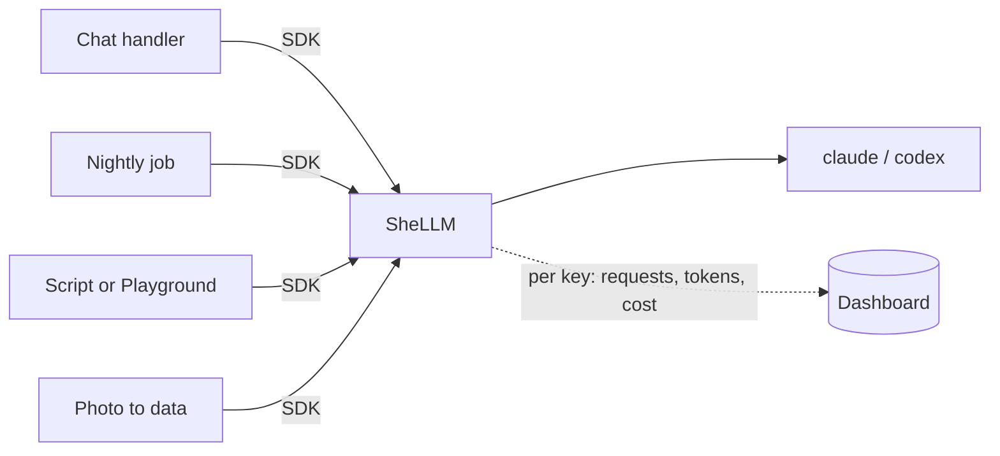
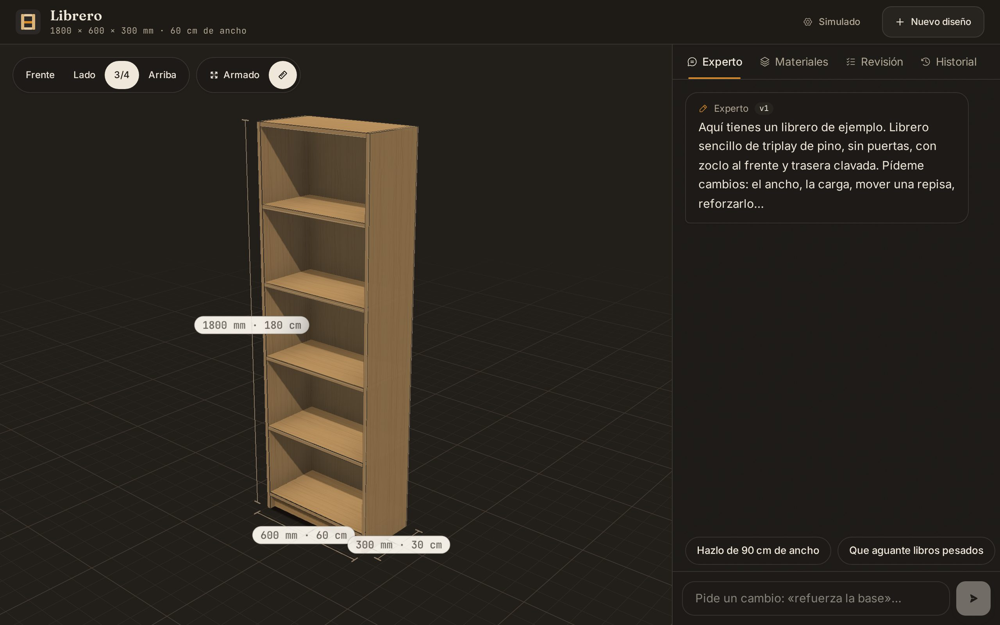
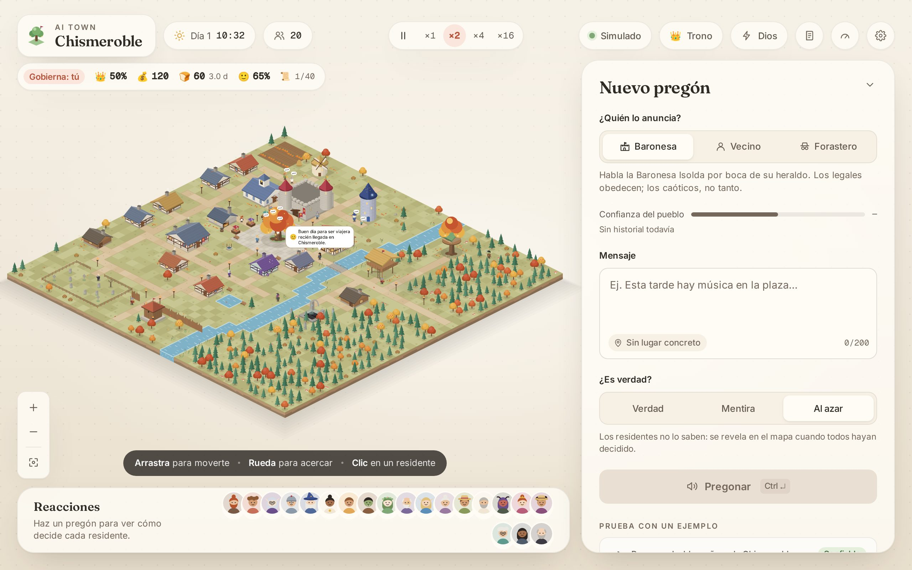
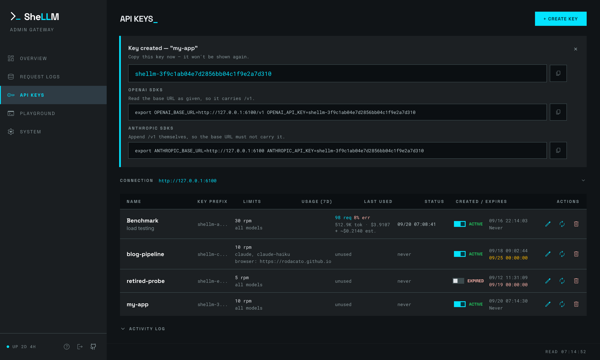
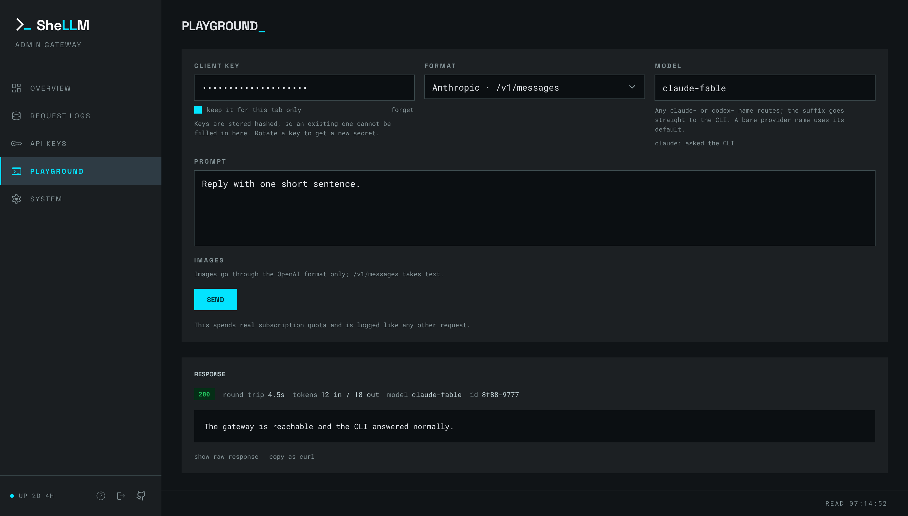
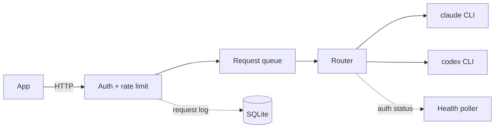

<p align="center">
  <picture>
    <source media="(prefers-color-scheme: dark)" srcset="design/brand/logo/logo-dark.svg">
    <source media="(prefers-color-scheme: light)" srcset="design/brand/logo/logo-light.svg">
    
  </picture>
</p>

<p align="center"><em>Your LLM subscription — as a REST API for your own apps.</em></p>

<p align="center">
  <a href="https://github.com/rodacato/SheLLM/actions/workflows/ci.yml"></a>
  <a href="https://github.com/rodacato/SheLLM/releases/latest"></a>
  <a href="LICENSE"></a>
</p>

<p align="center">
  <a href="https://rodacato.github.io/SheLLM/api/">API reference</a> ·
  <a href="docs/guides/usage.md">Calling it from your code</a> ·
  <a href="docs/guides/deployment.md">Running it on a server</a>
</p>

A personal project for experimenting with LLMs from your own software on the subscriptions you
already pay for. You pay for Claude Code or Codex; your own apps cannot use that subscription —
they need API credit you would buy separately. SheLLM runs the official CLI you already have,
unmodified, behind one HTTP endpoint that answers in both the OpenAI and the Anthropic formats, so
an official SDK pointed at it works on the first try. Driving the official binary is the
lowest-risk way to do this, not a risk-free one — see [Fair use and provider terms](#fair-use-and-provider-terms).

## What it is not

- **Not a way to share a subscription.** One owner, their own applications. No multi-tenant mode,
  no reselling capacity.
- **Not a backend for coding agents.** Claude Code, Cline, Aider and friends drive their own CLI;
  putting SheLLM in between adds latency and breaks their terms. Use it from software you wrote.
- **Not an API-key gateway.** If you pay per token, LiteLLM and OpenRouter do that better.
- **Not machine-scale.** Subscription quota is measured in human sessions, not throughput.

It does not work with Gemini (see below), with local runtimes like Ollama, or with any provider
that has no official CLI you can log into.

## Fair use and provider terms

SheLLM runs the **official, unmodified CLI binaries** and nothing else. It never extracts OAuth
tokens, never calls a provider's API with subscription credentials, and never pretends to be a
different client. If a change would make SheLLM faster by leaving the official binary, the answer
is no.

Running your own subscription through your own software still carries risk, and it is yours:

| Provider | Status |
|---|---|
| **Claude** (Claude Code) | Supported. Anthropic's terms forbid passing a Claude.ai login through another service; SheLLM never touches it — it spawns the official binary, which keeps its own login. |
| **Codex** (ChatGPT Plus/Pro/Business) | Supported, at your own risk. OpenAI documents `codex exec` for scripts and CI but recommends API keys for automation. No terms clause forbids wrapping your own subscription; OpenAI's automated abuse detection is the real exposure, and a suspension takes the whole ChatGPT account with it. |
| **Gemini** | Not supported. Gemini CLI stopped serving personal plans on 2026-06-18, and the terms of Google's Antigravity forbid "using the Service in connection with products not provided by us". |

Keep it human-scale. SheLLM never retries a request on its own, caps concurrent CLI processes
(`MAX_CONCURRENT`) and probes provider health with `claude auth status` and
`codex login status`, which spend no quota. Cross-provider fallback is off unless you turn it on with
`SHELLM_FALLBACK_ENABLED`; a request can opt out of it, never in. What is left to
you: one login per provider, and not pointing a batch job at it. If you need machine-scale
volume, buy API access — that is what it is for.

## What you'd build with it

You already pay the subscription, so the marginal request costs no extra money — it spends the same
quota your own sessions do — and for Claude the
CLI reports what that request *would* have cost on the API, attributed to the key that made it.
Build the feature, run it for a week, and you know the bill before you decide to pay one. Codex
reports tokens but no cost, so its requests carry an estimate at API list price, marked `est.` and
kept apart from the reported figure ([ADR-0012](docs/adr/0012-estimated-cost-from-a-price-manifest.md)).

Four shapes, one integration — an official SDK with the base URL and the key swapped:



**A chatbot or an assistant inside your app.** Someone is waiting, so latency is the constraint:
the floor for any answer is about 2.5 s ([benchmarks](docs/guides/benchmarks.md)) and only
`MAX_CONCURRENT` requests run at a time. Fine for one person talking to your app; not a support queue.

**A nightly report over your own data.** A cron job that reads yesterday's rows and leaves a
summary you find in the morning. **One report, not one per row** — pushing a backlog through a
subscription is what gets accounts flagged, and it is the same boundary as "not machine-scale"
above.

**Trying a prompt or a model before it becomes a feature.** The playground sends a real request
down the same path your app takes, and the same key then works from a shell script. Give each
experiment its own key and the dashboard answers which of them is worth paying for.

**Turning photos into structured data.** Send the photos as `data:` URL images with a
`response_format` JSON Schema, and the answer is JSON that matches it — streamed if you ask, in one
piece once the CLI has validated it. [Knotty](https://github.com/rodacato/knotty) does this from a static page: photos of a
piece of furniture in, a parametric plywood design out. Resize in the client first; Claude scales
anything past about 1568 px down anyway, so a bigger photo only costs upload time.

## Built on it

| [Knotty](https://rodacato.github.io/knotty/) | [AI Town](https://rodacato.github.io/ai-town/) |
|---|---|
| [](https://rodacato.github.io/knotty/) | [](https://rodacato.github.io/ai-town/) |
| Photos of a piece of furniture in, a plywood design out, then adjusted by talking to a carpenter. Images and a JSON Schema answer, straight from the browser. | Twenty villagers hear a proclamation and each decides what to do: the same prompts through any model, to compare decisions, latency, tokens and cost. Either format, many small calls. |

## Getting started

Requires Node.js 24.22 or newer and a logged-in `claude` (or `codex`) on the same machine. With a
system-wide Node, `npm link` writes to the global prefix and needs `sudo`.

```bash
git clone https://github.com/rodacato/SheLLM.git && cd SheLLM
npm install && npm link    # dependencies and the shellm command
shellm init                # config file, Claude token, first API key, checks
shellm start
```

`shellm init` asks for the token from `claude setup-token`, which is how the service
authenticates. Pressing Enter falls back to your user's own `claude` login, which works until it
expires; `shellm doctor` warns while it is in use. `shellm init` then writes `~/.config/shellm/env` with mode 600, prints your first
API key once, writes the load limits so they are values you can see rather than defaults you have
to read the source for, and runs the checks. `shellm doctor` repeats them later; `shellm doctor --live`
sends one real request.

Then, with the key it printed:

```bash
export SHELLM_KEY=shellm-...   # the key init printed, shown once

curl http://127.0.0.1:6100/v1/chat/completions \
  -H "Authorization: Bearer $SHELLM_KEY" -H "Content-Type: application/json" \
  -d '{"model": "claude-haiku", "messages": [{"role": "user", "content": "Name the three primary colors, comma-separated."}]}'
```

Official SDKs need no code change:

```bash
export OPENAI_BASE_URL=http://127.0.0.1:6100/v1 OPENAI_API_KEY=$SHELLM_KEY
export ANTHROPIC_BASE_URL=http://127.0.0.1:6100 ANTHROPIC_API_KEY=$SHELLM_KEY
```

Those two lines are on the dashboard's API Keys page with your own address filled in, and with the
key filled in too on the one screen that ever shows it.

For a server, [`docs/guides/deployment.md`](docs/guides/deployment.md) covers
`scripts/setup/vps.sh`, the systemd unit and logging a CLI in on a headless machine. Two commands
matter once it is running: `shellm update` moves the host to the newest published release and
rolls back on its own if the service does not come up, and `shellm backup` writes a consistent
snapshot of the database and the config file for whatever you already use to carry backups off a
host.

To call it from your own code — SDK snippets, what Claude can and cannot do through the API, the
limits you will hit — read [`docs/guides/usage.md`](docs/guides/usage.md).

## The dashboard

`/admin` is where the keys, the request log and provider health live. Browsers sign in at
`/admin/login` — any username unless `SHELLM_ADMIN_USER` is set, with the password `shellm init`
printed; scripts use HTTP Basic with the same `SHELLM_ADMIN_PASSWORD`. Over HTTPS it installs as
an app: its own window and icon, and a warm start. Not an offline dashboard — every number on it
comes from the gateway ([ADR-0007](docs/adr/0007-installed-dashboard-is-a-launcher.md)).


Every request is logged with what it cost and how long the CLI took, so "which app is burning the
subscription" is a question with an answer. Nothing about the prompt is stored or inspected.



A key is shown once and never again, so the page shows it beside the two lines that use it — the
OpenAI base URL carries `/v1`, the Anthropic one must not. The connection row below keeps the base URL
in view and opens onto those same two lines against `$SHELLM_KEY`, which is what a key created
months ago still needs.



The playground sends a real request through the same path your app takes, with the same key.

## Models

| Provider | Models |
|---|---|
| Claude | `claude` (the CLI's default), `claude-haiku`, `claude-sonnet`, `claude-opus`, and any other `claude-*` id the CLI accepts |
| Codex | `codex` (the default model of the baked catalog) and any `codex-<model>` id, for example `codex-gpt-5.6-sol` |

A model the CLI rejects comes back as `404 model_not_found`. How a name becomes a CLI flag, and
what `GET /v1/models` reports, is in [`docs/guides/usage.md`](docs/guides/usage.md#3-naming-a-model).

## API

| Endpoint | Notes |
|---|---|
| `POST /v1/chat/completions` | OpenAI format, including streaming, `response_format` JSON Schema and `data:` URL images |
| `POST /v1/messages` | Anthropic format, including streaming and `output_config.format` |
| `GET /v1/models` | OpenAI model list, each model with its context window and reasoning efforts |
| `GET /health` | `{ "status": "ok" }`, unauthenticated |
| `/admin/*` | Keys, request logs and provider status — see [The dashboard](#the-dashboard) |

Requests to `/v1/*` take the key as `Authorization: Bearer <key>` or `x-api-key`, and errors come
back in the format of the endpoint you called. The status codes and what to do about each are in
[`docs/guides/usage.md`](docs/guides/usage.md#7-errors); parameter-by-parameter support is in
[`docs/guides/api-compatibility.md`](docs/guides/api-compatibility.md).

The full contract — request and response schemas, the admin endpoints, streaming — is the
OpenAPI document in [`docs/api/openapi.yaml`](docs/api/openapi.yaml). A running instance serves
the bundled version of it at `/docs/openapi.json`, and `npm run docs:preview` opens it as a page.

## Using SheLLM from a browser

A page on another origin — `https://you.github.io`, `http://localhost:5173` — can call `/v1`
directly once you allow its origin:

```bash
SHELLM_CORS_ORIGINS=https://you.github.io,http://localhost:5173
```

Exact match, one entry per origin — scheme, host and port, no path and no trailing slash. There is
no wildcard: `*` matches nothing, because a page you did not mean to allow should fail rather than
inherit access. The list covers `/v1` only; the admin endpoints never answer a cross-origin
request, so no page can read your keys or your logs.

Whatever you ship to a browser is public, so give the page a key of its own and scope it to the
page's origin. Getting past the browser's six connections per host (HTTP/2 through Caddy), TLS
without a proxy, and reading queue and timing figures back from JavaScript are in
[`docs/guides/usage.md`](docs/guides/usage.md#10-calling-it-from-a-browser).

## CLI

`shellm help` lists every command and its options. Besides the ones above, `shellm status` reports
whether the server answers and `shellm config` shows the settings in effect.

## Configuration

Settings live in `~/.config/shellm/env`, written by `shellm init` with mode 600 and read at
startup. Anything not set there falls back to a default declared in
[`src/config/schema.js`](src/config/schema.js) — the single place a default exists.
[`.env.example`](.env.example) is the full reference list and is **generated** from that schema by
`npm run config:build`, so edit the schema and never the generated file.

`shellm config` prints every setting with the value in effect and where it came from (`default`,
`config file` or `environment`; the real environment wins over the file). After an update,
`shellm doctor` and the dashboard's System page list the settings the new release added that your
file does not set, and `shellm config --new` prints each one with a line ready to paste.

**Editing the config file needs a restart**, whatever the `RELOAD` column says: the file is loaded
into the environment once, when the process starts. On a server that is
`sudo systemctl restart shellm`; [`docs/guides/deployment.md`](docs/guides/deployment.md#3-configure)
has the commands for editing the file as the service user.

## How it works



Each request spawns a CLI process in its own temporary directory and discards it, so nothing leaks
between requests — about 0.9 s of process startup, inside a floor of roughly 2.5 s for the whole
short answer, measured on a production server in
[`docs/guides/benchmarks.md`](docs/guides/benchmarks.md). SQLite holds keys, request logs and the
audit trail. [`docs/guides/architecture.md`](docs/guides/architecture.md) has the module
map and [`docs/adr/`](docs/adr/) the decisions.

## Contributing

[CONTRIBUTING.md](CONTRIBUTING.md) covers setup, conventions, tests and adding a provider. Release
history is in [CHANGELOG.md](CHANGELOG.md).

Found a security problem? Do not open an issue — report it through
[the private advisory form](https://github.com/rodacato/SheLLM/security/advisories/new).
[SECURITY.md](SECURITY.md) has the scope, the threat model and the disclosure timeline.

The [brand guide](https://rodacato.github.io/SheLLM/brand/) provides the logo and social assets.
[`design/brand/`](design/brand/README.md) holds the identity sources, usage and regeneration steps.

## License

[MIT](LICENSE)
